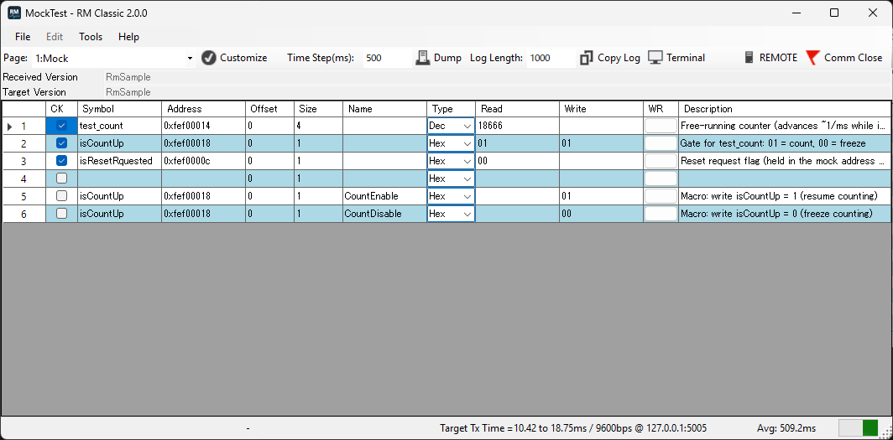

# RM Classic: Real-Time Variable Monitoring for Embedded Systems

[](LICENSE)
[](#requirements)
[](https://github.com/NaoNaoMe/RM-Classic/releases)

**RM Classic** is a real-time data monitoring tool for embedded systems development. It lets you observe and modify live variables in a running MCU over UART — all you need is a serial connection, no JTAG adapter or debug probe required.



## Requirements

- Windows 10 or later
- No installation — download the single `.exe` from [Releases](https://github.com/NaoNaoMe/RM-Classic/releases)

## Features

### Real-Time Variable Monitoring

Observe statically allocated variables by address and type. Values update continuously without halting the MCU or requiring breakpoints.

### Data Injection

Write new values to variables at runtime to test parameter changes or directly override system behavior.

### Remote Operation

RM Classic exposes a TCP server interface that allows external programs to read and write variables programmatically.

- **Automated test sequences** — drive parameter changes and read results from Python or MATLAB with precise, repeatable timing.
- **Instrument integration** — synchronize with external measurement devices to automate data collection and inspection workflows.

### Data Logging

All observed values are recorded continuously in the background. Use **Copy Log** to capture a snapshot at any moment; use **Dump** to read a raw block of MCU memory by address and size.

### Terminal

A built-in terminal — similar to the Arduino IDE Serial Monitor — lets you send and receive plain text over the same UART connection alongside the monitoring protocol, useful for printf-style debug output from firmware.

## Quick Start

The following example uses an Arduino Uno with the [rm_embedded](https://github.com/NaoNaoMe/rm_embedded) sample sketch.

1. **Flash the MCU** — upload `RmSample/RmSample.ino` to your Arduino Uno.
2. **Connect** the Arduino to your PC.
3. **Download RM Classic** from [Releases](https://github.com/NaoNaoMe/RM-Classic/releases) and run the `.exe`.
4. **Load the configuration** — go to **File > Open > View File** and open `RMConfiguration--RmSample.rmxml` (included in the rm_embedded repository).
5. **Configure the connection** — set baud rate to **9600 bps**, password to **`0x0000FFFF`**, and address width to **2 bytes**.
6. **Connect** — click **Comm Open**. The version string `RmSample` confirms a successful connection.

Variables such as `count` and `isCounting` are now visible and editable in real time.

## Configuration files

RM Classic uses two kinds of files. Only the view is required.

### The view (`.rmxml`)

A view defines the set of variables you monitor and control. Each entry specifies a
symbol, address, offset, size, and display type (`Dec` / `Hex` / float / ...), and
entries can be grouped into pages and given friendly names, descriptions, and preset
write values that act as one-click macros. Views are saved as `.rmxml` files and
reused across sessions. Since every entry already carries its own address, a view
together with the matching ROM image is enough to observe internal values and use
special features — no toolchain or build output is required. Open a view via
**File > Open > View File**, or with `openview` over the remote interface.

### The symbol map (optional)

A symbol map lets you reference variables by name instead of entering raw addresses,
which is convenient while firmware is still under active development and addresses
change on every build. When a map is loaded, RM Classic resolves each symbol in the
view and fills in its address, size, and offset automatically; if the map file is
later updated (for example, after a rebuild), RM Classic offers to reload it and
re-syncs the entire view to the new addresses. Supported formats include **ReadELF**
output, **nm**, and **GCC linker maps**, as well as a compact `.rmmap` file
(`symbol,address,offset,size`) — an RM-Classic-specific format produced by a
separate converter rather than by the IDE.

This automatic re-sync is a GUI convenience only — a remote/scripted session has no
way to observe a silent change, so it is suppressed there. Use the `resyncmap`
command instead, which re-syncs on demand and returns a report of what was updated
and what could no longer be resolved.

## Remote Control for Scripts & AI Agents

For practice without hardware, AI agents use [rm_mock](https://github.com/NaoNaoMe/rm_mock) —
a software MCU reached over **TCP/IP** (LocalNet connection mode) instead of a
serial port. See its repository for details.

Start RM Classic as a TCP server with `--remote <ip> <port>`, then connect and
send commands (each line terminated by `\r\n`):

```
RM-Classic.exe --remote 127.0.0.2 4001
```

Run `RM-Classic.exe --help` for the command-line usage.

The GUI stays open while the remote server runs, so a human can watch live values
and intervene (change a display type, stop logging, ...) alongside the script.
Launch it as a normal visible window — do **not** hide the window — whenever that
oversight is wanted; reserve a hidden launch for fully unattended runs.

The remote interface is self-describing, so a script (or an AI agent) can operate
it by referring to the `help` command:

- `help` — machine-readable JSON catalog of every command.

A few things a script should know that aren't obvious from a quick glance:

- `status` reports `viewPath`/`mapPath` — which file (if any) the currently loaded
  view/map came from; empty when loaded from uploaded content instead of a path.
- `view`/`logheader` report each variable's display type; valid values are `Bin`,
  `Dec`, `UsD`, `Hex`, `FLT`, `DBL` — an unrecognized type disables that row rather
  than silently reinterpreting it.
- `dump` is a single, timestamp-free snapshot with no correlation across calls; for
  anything observed over time use `logstart` + `logread`/`logreadall` instead.
- `openview`/`openmap` take a path RM Classic itself must be able to read (not the
  calling script's filesystem) — use an absolute path. A missing file is reported
  distinctly from a malformed one.


## Protocol

The wire format between RM Classic and MCU firmware is documented in [RM\_Protocol\_Specification.md](RM_Protocol_Specification.md).

## MCU Integration

Firmware library and integration examples for connecting MCUs to RM Classic are available in the [rm_embedded](https://github.com/NaoNaoMe/rm_embedded) repository.

## License

This project is licensed under the MIT License. See the [LICENSE](LICENSE) file for details.